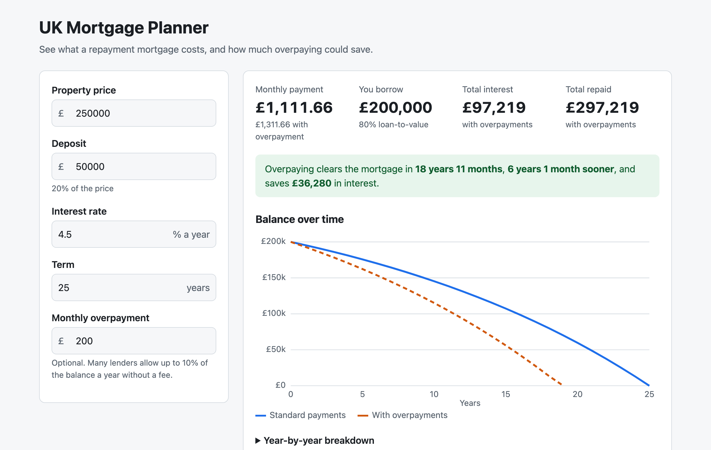

# UK Mortgage Planner

[](https://github.com/rebecafecioru/uk-mortgage-planner/actions/workflows/deploy.yml)

**Live demo: [rebecafecioru.github.io/uk-mortgage-planner](https://rebecafecioru.github.io/uk-mortgage-planner/)**

A calculator for UK repayment mortgages: the monthly payment, total interest and
loan-to-value, and how much a monthly overpayment saves, in years and in pounds.



Built with React 19, TypeScript (strict mode) and Vite. Tested with Vitest and React
Testing Library, and deployed to GitHub Pages by GitHub Actions.

## Features

- **Live results** as you type: monthly payment, amount borrowed, loan-to-value (LTV),
  total interest and total repaid.
- **Overpayments:** see when the mortgage would be cleared and how much interest you'd save,
  with both balances drawn on one chart.
- **Year-by-year breakdown** of interest paid, capital repaid and balance left.
- **Shareable links:** the inputs live in the URL (`?price=250000&rate=4.5...`), so a link
  reopens the same numbers.
- **Accessible:** every input has a label, errors are linked to their field with
  `aria-describedby`, results are announced through an `aria-live` region, and the chart has
  a text description.
- **Responsive, with dark mode** from the system setting.

## How it works

The maths lives in [`src/mortgage.ts`](src/mortgage.ts) as pure functions, separate from
the UI, which makes it easy to test.

- **Monthly payment** uses the standard repayment formula, where *P* is the loan, *r* the
  monthly rate (annual rate ÷ 12) and *n* the number of months:

  &nbsp;&nbsp;&nbsp;&nbsp;payment = P × r / (1 − (1 + r)<sup>−n</sup>)

- **Amortisation schedule:** each month the interest is `balance × r`, and the rest of the
  payment, plus any overpayment, reduces the balance. Overpaying lowers the balance sooner,
  so less interest builds up afterwards.

Design decisions:

- **Results are derived, not stored.** They're recalculated from the inputs with `useMemo`,
  so they can never fall out of sync with the form.
- **Inputs stay as text while you type.** An empty box is a validation error, not a silent £0.
- **The chart is plain SVG**, with no chart library: two scale functions map years and pounds
  to pixels, and each line is a `<polyline>`.

## Run it

```bash
npm install
npm run dev       # http://localhost:5173/uk-mortgage-planner/
npm test          # Vitest + React Testing Library
npm run lint
npm run build
```

## Tests

36 tests cover:
- the maths against a known figure (£200,000 at 5% over 25 years is £1,169.18 a month)
- edge cases: 0% interest, an overpayment that clears the loan at once, a final part year
- validation, formatting, and reading and writing the URL
- the UI, the way a user would use it: typing into labelled fields, checking results and
  errors on screen, and checking the URL updates

To make sure the tests can actually fail, I broke the interest formula on purpose. Four
tests caught it.

## Limitations

Assumes one fixed rate for the whole term. Real UK deals usually fix for 2–5 years and then
change rate, and may have fees and overpayment limits. Not financial advice.
